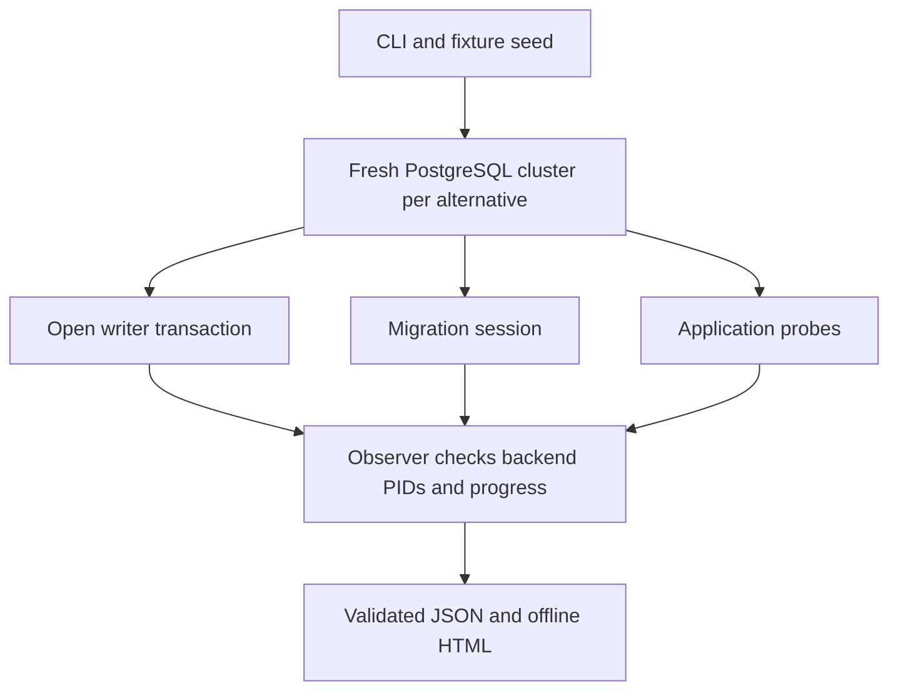

# pg-rollout-witness

A migration can finish successfully while the old application is still broken. Rehearse the rollout on generated rows, inspect the affected request and see what PostgreSQL retained after cancellation.

**[Download the offline HTML report](https://github.com/Karthikvk1899/pg-rollout-witness/raw/refs/heads/main/preview/report.html)** · [Inspect the captured events](preview/report.json) · [CI](https://github.com/Karthikvk1899/pg-rollout-witness/actions/workflows/rehearse.yml)

| Trial in the example report | What the reviewer can verify |
| --- | --- |
| Ordinary unique index | Writer PID 70 queued behind migration PID 69, which queued behind PID 68. The write succeeded in 1,205.165 ms against a 1,200 ms budget. |
| Concurrent unique index | The old writer finished in 0.730 ms while the migration waited for the earlier transaction. |
| Cancel and retry | At “waiting for writers before build,” cancellation returned 57014. The index existed with ready=false and valid=false. Removal and retry produced a valid unique index. A duplicate then failed with 23505. |
| Immediate rename | DDL succeeded. The old read failed with 42703 and the new read returned its expected value. |
| Expand and contract | Both declared reads passed after backfill. The new read passed after the old reader retired and the old column was dropped. |

These numbers describe one PostgreSQL 16.2 run. The held transaction intentionally spans the ordinary writer’s budget. Use the comparison to choose a DDL strategy under this contention pattern. Use separate production measurements for capacity planning.

## Try it

Use Linux x86-64, a non-root account, and [uv](https://docs.astral.sh/uv/getting-started/installation/). From a checkout run:

```sh
sh demo
```

The first run resolves the locked Python 3.12 environment and downloads PostgreSQL through the pgserver wheel. Open `out/report.html` directly. Choose an affected request to see its SQLSTATE, backend PID or linked wait observation. Expand “after cancellation” and “after completion” to compare the catalog flags. All report assets are inline.

```sh
sh demo --scenario index --out out/index
sh demo --scenario columns --out out/columns
```

To use an installed PostgreSQL 16 distribution, set `WITNESS_PGBIN` to its trusted absolute bin directory (for example `/usr/lib/postgresql/16/bin`), install with `python -m pip install .` in a virtual environment, and run `pg-rollout-witness demo`. The runner always creates its own cluster. It accepts no connection URL.

## Bring a migration

The example adds a priority column to orders. An old client then inserts a row without supplying priority. A new client must read the default from that very row.

```sh
uv run --locked --extra embedded pg-rollout-witness run \
  --fixture examples/fixture.sql --migration examples/migration.sql \
  --workload examples/workload.json --out out/orders
```

Copy the [fixture](examples/fixture.sql), [migration](examples/migration.sql) and [workload](examples/workload.json). The fixture is UTF-8 SQL executed once as the rehearsal role. Derive synthetic values from `current_setting('witness.seed')` (`--seed` defaults to 41). Use deterministic generators and stable ordering. The migration is sent as one SQL message. Supply a single top-level statement for commands requiring autocommit, including concurrent index construction. Multiple ordinary DDL statements in a message share PostgreSQL's implicit transaction.

The [workload contract](witness/workload-v1.json) accepts ordered `before` and `after` requests, each on a fresh application connection with committed side effects. Supply a public label, client (old/new), a stage, SQL and optional positional parameters using Psycopg’s %s syntax. Optional `expect` compares the **first row** to a single expected scalar. Omitting it checks statement completion. Optional `budget_ms` measures client-observed execution, including fetching the asserted row. Baseline failure stops the custom trial. The index demo adds controlled *during-DDL* traffic in code. Arbitrary custom workloads support the two documented stages.

## Reading a verdict

| Verdict | Release implication |
| --- | --- |
| pass | Each exercised case met its declared assertion and budget. |
| application_failure | Inspect the failed request, SQLSTATE or scalar mismatch before retiring an application version. |
| migration_failure | The migration returned a PostgreSQL error. |
| budget_violation | A measured request exceeded its budget. Inspect the PID-linked observation before attributing a blocker. |
| recovered | This cancellation, residue inspection, removal, identical retry and post-retry application check completed. |
| inconclusive | A required phase, connection, catalog condition or observation was unavailable. |

The CLI emits a JSON summary on stdout. Exit 0 means the custom gate passed or the demo produced its expected positive **and negative** controls. Exit 1 means a custom regression or an unexpected demo outcome. Exit 2 covers invalid inputs or arguments, 3 incomplete evidence, and 130 an interrupted runner. If multiple findings coexist, all events are retained. An inconclusive trial takes precedence across trials. Within a completed trial, migration failure takes precedence over application failure, then budget violation.

## Architecture and evidence



The first transaction writes row 1. A second session starts the index build. The observer polls pg_blocking_pids, pg_stat_activity, pg_locks and pg_stat_progress_create_index by PID. Only a matching sample releases the next step. A different connection updates row 2. For ordinary builds we record its queue edge before holding the gate through the budget. For concurrent builds we require the write to return before releasing the gate. The third fresh trial cancels only after sampling the concurrent build phase and matching blocker. It inspects pg_index, drops the invalid index concurrently, retries the same SQL, checks readiness and validity, then exercises permitted and duplicate writes.

Each alternative initializes an independent cluster from identical fixture SQL and seed. PIDs, time measurements and scheduler order can vary. A wait sample shows what PostgreSQL reported at that instant. Short waits can escape sampling. The column workload declares **read-only access to the renamed field**. Applications writing both representations need a synchronization or dual-write policy and their own write/read assertions.

[Report schema v1](witness/report-v1.json) defines the artifact consumed by CI. Each trial has a PostgreSQL version, verdict, reviewer decision and ordered event list. SQL events carry the SHA-256 digest of the UTF-8 statement, backend PID, elapsed milliseconds and SQLSTATE. Catalog events distinguish absent indexes from false flags. The environment records fixture and workload digests, seed, runner and Python versions, platform and budgets. Instrumented request events are appended on completion. Each output directory belongs to one run. Always use a fresh output path when collecting independent runs.

## Trust boundary and troubleshooting

Run trusted synthetic SQL locally. Each temporary data directory is private. A fresh random SCRAM credential protects each role, the listener binds only to loopback, and migration SQL runs as a non-superuser in its own schema. The supervisor holds monitoring and cancellation privileges. Report events omit SQL text, parameters, returned values, server detail messages and credentials. Names in the workload are public labels.

A PostgreSQL process on the runner shares its OS user's privileges and resource limits. Arbitrary PR code and SQL require a disposable, secret-free VM or container with resource limits, no production connectivity and a read-only repository token. Review workflow changes. Use pull_request, never privileged pull_request_target execution of PR code. The [workflow](.github/workflows/rehearse.yml) disables checkout credential persistence, bounds job duration and retains out/ with always(), including failed gates. Download reports only from runs whose code you trust.

The observation deadline is five seconds, the default server statement timeout is twenty seconds, and idle transactions expire after thirty seconds. A constrained host can yield inconclusive evidence or a genuine budget miss. Inspect the stage before rerunning. Startup requires initdb and pg_ctl from the same distribution and permission to bind a loopback port. Another process taking the selected port produces a startup failure. Run as an unprivileged user. SIGINT/SIGTERM unwind the experiment and stop the owned cluster. A forced kill or host crash may leave a temporary cluster behind. Inspect its postmaster.pid and data directory before stopping that specific cluster with pg_ctl. Use disposable CI runners for hard termination.

## Prior art

[Squawk](https://squawkhq.com/) surfaces risky statements during editing and review. [Atlas](https://atlasgo.io/versioned/diff) plans migrations from schema differences. [pgTAP](https://pgtap.org/) supports database-level assertions. [Rehearsal](https://marketplace.visualstudio.com/items?itemName=azizguenni.rehearsal) already measures migrations on real PostgreSQL. This project focuses on one release decision that needs multiple sessions, captured blockers, old/new requests and evidence from cancellation through retry. The name distinguishes it from Rehearsal. See PostgreSQL’s [CREATE INDEX progress phases](https://www.postgresql.org/docs/16/progress-reporting.html#CREATE-INDEX-PROGRESS-REPORTING) and [concurrent index behavior](https://www.postgresql.org/docs/16/sql-createindex.html#SQL-CREATEINDEX-CONCURRENTLY).

## Development

Run `sh demo` and then `uv run --locked --extra embedded python -m unittest discover -s tests -v`. The integration suite invokes the installed CLI outside the repository, verifies blocker relationships, SQLSTATEs, catalog flags, custom gates and shutdown. CI also opens the offline report in Chrome and follows evidence links.

MIT licensed. See [LICENSE](LICENSE).
